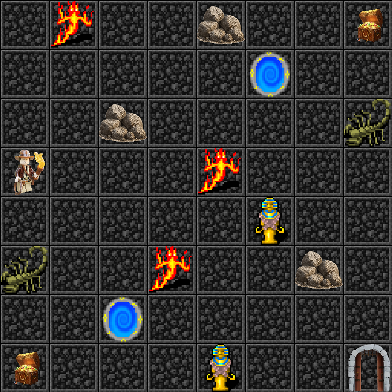

# Tomb Escape — Q-Learning

A reinforcement learning agent that learns to escape an 8x8 grid-world tomb using
**tabular Q-learning**. Built with a custom [Gymnasium](https://gymnasium.farama.org/)
environment and rendered live with pygame.



## What this project is about

Q-learning is a model-free RL algorithm: the agent doesn't know the rules of the world
upfront, it only knows its current position and the rewards it receives. Over thousands
of trial-and-error episodes, it builds a table of **Q-values** — one value per
(state, action) pair — estimating "how good is it to take this action from this state?"
Once trained, the agent picks the highest-value action at every step (the *greedy policy*)
and reliably navigates the tomb.

What makes this environment harder than a typical gridworld tutorial is the **gated exit**:
the agent cannot simply walk to the exit and win. It must first collect *both* treasures,
scattered at opposite corners of the grid, before the exit will accept it. This forces the
agent to learn a multi-step plan rather than a single shortest path, and means the reward
signal for "reaching the exit" only applies in the right circumstances — the environment
has to track per-episode state (which treasures are collected) to know whether the exit is
currently terminal or just another floor tile.

## The environment

The agent starts at `(3,0)`. Layout:

| Cell type       | Position(s)                         | Reward | Ends episode? |
|-----------------|--------------------------------------|-------:|:--------------:|
| Treasure        | `(0,7)`, `(7,0)`                     |  +8.0  | No (once per episode each) |
| Exit (gated)    | `(7,7)` — only once both treasures collected | +20.0 | Yes |
| Exit (not yet gated) | `(7,7)` before both treasures | -0.01 | No — acts like a normal tile |
| Fire pit        | `(0,1)`, `(3,4)`, `(5,3)`             | -10.0  | No |
| Scorpion        | `(2,7)`, `(5,0)`                     |  -8.0  | No |
| Boulder trap    | `(0,4)`, `(2,2)`, `(5,6)`             | -15.0  | Yes |
| Mummy guard     | `(4,5)`, `(7,4)`                     | -15.0  | Yes |
| Warp pad        | `(6,2)` ↔ `(1,5)` (bidirectional, instant teleport) |  -0.01 | No |
| Normal floor    | everywhere else                      |  -0.01 | No |

Actions are the 4 cardinal moves: `0=Up`, `1=Down`, `2=Left`, `3=Right`.

## Files

| File | Purpose |
|---|---|
| `indiana_jones_env.py` | The Gymnasium environment: grid layout, reward rules, pygame rendering |
| `q_learning_agent.py`  | Training loop (`train_q_learning`), plotting helpers, Q-table visualisation, greedy evaluation |
| `main.py`              | Entry point — flip the flags at the top to train / run experiments / visualize / evaluate / watch the agent play |
| `q_table.npy`          | The submitted trained agent (fixed start, gated exit) — reaches the exit in **500/500** greedy evaluation episodes |
| `Grid_icons/`          | Sprites used for rendering (floor, treasure, boulder, mummy, etc.) |
| `policy_images/`       | Saved Q-value heatmaps and greedy-policy diagrams, one set per "phase" of the task (before 1st treasure, before 2nd, before exit) |

## Running it

```bash
pip install -r requirements.txt
python main.py
```

`main.py` is controlled by boolean flags near the top of the file — set the one you want
to run and leave the rest `False`:

| Flag | What it does |
|---|---|
| `render_greedy` (on by default) | Loads `q_table.npy` and watches the trained agent play 3 episodes in a pygame window |
| `train` | Train a fresh agent from `(3,0)` for 20,000 episodes, save `q_table.npy`, and plot the learning curve |
| `run_experiments` | Compare 3 learning rates (α) and 2 ε-decay strategies, with comparison plots |
| `visualize` | Show the saved Q-value heatmaps and greedy policy for each phase |
| `evaluate` | Run 500 purely greedy episodes (ε=0) from `(3,0)` and print a pass/fail summary |
| `random_init_compare` | Train a second agent from random start cells each episode, then compare both agents' greedy performance from random starts — tests whether the fixed-start policy actually generalises or just memorised one path |

### Quick look at the environment without training

```bash
python indiana_jones_env.py
```
Opens the pygame window, saves a screenshot (`tomb_grid.png`), and runs a random
(untrained) agent for a few episodes — useful for checking the layout and rendering
without touching the Q-learning code.

## Results

- The submitted Q-table (`q_table.npy`, fixed start) reaches the exit in **500/500**
  greedy evaluation episodes — i.e. with exploration turned off, it never fails.
- `policy_images/` contains the Q-value heatmap and the resulting greedy-policy arrows
  for each of the three phases the agent passes through (before collecting either
  treasure, after the first, after the second).
- `random_init_compare` (optional) shows how much of the fixed-start agent's success
  depends on having memorised the specific starting corridor versus a genuinely
  general tomb-navigation policy.

## Key hyperparameters

```
episodes      = 20,000
max_steps     = 200       # cap per episode, prevents infinite loops on non-terminal states
gamma         = 0.99      # high discount — the final exit reward is many steps away from the start
alpha         = 0.1       # learning rate
epsilon       = 1.0 → 0.05, decay 0.9995   # slow decay — an 8x8 grid with 3 sub-goals needs sustained exploration
```
